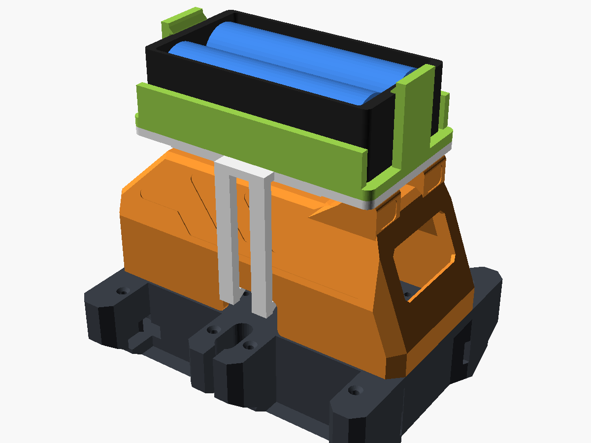

# Sesame на ESP32 DevKit и двух 14500

Форк [Sesame](https://github.com/dorianborian/sesame-robot) (автор Dorian Todd, Apache-2.0), собранный из того, что было под рукой:
обычная ESP32 DevKit вместо S2 Mini и две банки 14500 в открытом отсеке на спине вместо аккумулятора в раме.

Отличия от оригинала:
- в `firmware/sesame-firmware-main.ino` и `firmware/debugging-firmware/sesame-motor-tester.ino` включены выводы для ESP32 DevKit
  (те же, что у оригинальной Distro Board V1 — она тоже стоит на DevKit): сервы `15, 2, 23, 19, 4, 16, 17, 18`, экран SDA 21 / SCL 22;
- `hardware/battery-mount/` — седло и лоток под отсек 2×AA на спину (OpenSCAD, STL, картинки);
- `tools/flash.sh` — сборка и прошивка через `arduino-cli`.

Свежие изменения автора подтягиваются так: `git fetch upstream && git merge upstream/main`.

## Что нужно

| Что | Шт. |
| --- | --- |
| MG90S 180° | 8 |
| ESP32 DevKit (30 пинов) | 1 |
| OLED 0,96″ SSD1306 I²C | 1 |
| Li-ion 14500 Soshine 900 мАч | 2 |
| Открытый отсек 2×AA (≈58 × 31 × 16 мм), банки последовательно | 1 |
| Понижайка Mini560 PRO 5 В 5 А | 1 |
| Выключатель-клавиша (KCD1, в вырез крышки) | 1 |
| Конденсатор 1000 мкФ, 10 В и больше | 1 |
| Кусочек макетки, 8 трёхпиновых гребёнок, провода | |
| Саморезы M2×5 | ~44 |
| Пауэрбанк 5V⎓3A и USB-кабель под разрез — только для стола | |

## Питание

Ходовое: 2 × 14500 последовательно (7,4 В) в открытом отсеке на спине → выключатель → Mini560 PRO → 5 В на шины.
Сервы MG90S рассчитаны на 4,8–6 В, DevKit берёт 5 В на вывод VIN — всё сидит на одних 5 В.

Сколько берут MG90S на 5 В: под весом робота 0,3–0,5 А каждая, в упоре до 0,75 А.
Mini560 PRO отдаёт 5 А — это 6 серв в упоре одновременно. Все 8 в упоре разом — до 6 А, но прошивка Sesame двигает сервы по очереди
(«Motor Current Delay»), так что больше половины одновременно не тянет.

Банки заряжаются вынутыми, в обычной зарядке для Li-ion: отсек открытый, банки вынимаются сверху, лоток им не мешает.

**Пауэрбанк — только на столе / на проводе.** Выключатель выключен, разрезанный кабель пауэрбанка идёт прямо на шины макетки
(красный +5 В, чёрный GND). Пауэрбанк нужен с 5V⎓3A на этикетке, обычно это USB-C PD на 20 Вт и больше.
- **USB-A на пауэрбанке** — режешь любой USB-A кабель.
- **Только USB-C** — режешь C-кабель и ставишь резистор 5,1 кОм между проводом CC и GND (CC ищется прозвонкой до контакта CC на штекере).
  Без него USB-C порт пауэрбанка не включает 5 В.

## Печать

Creality K1 Max, PETG, Creality Print. STL корпуса — `hardware/printing/stl/`, крепление отсека — `hardware/battery-mount/stl/`.
Всё помещается на одну плиту 300 × 300, но верхнюю крышку лучше печатать отдельно: она единственная с поддержками.

**Сначала — плита 1** (всё без поддержек, с неё начинается сборка: сервы ставятся в раму и суставы):

| Файл | Шт. | Как положить |
| --- | --- | --- |
| `R1`–`R4`, `L1`–`L4` (v117) | по 1 | автоориентация — квадратной площадкой вверх, как у автора |
| `Internal-Frame-v121` | 1 | «Положить на грань» (F) → верхняя плоскость рамы на стол, она целиком плоская |
| `Bottom-Cover-v121` | 1 | «Положить на грань» → наружная (нижняя) плоскость на стол |
| `battery-mount/stl/saddle.stl` | 1 | как есть: пластиной вниз, пальцы вверх |
| `battery-mount/stl/tray.stl` | 1 | как есть: дном вниз |

**Плита 2:**

| Файл | Шт. | Как положить |
| --- | --- | --- |
| `top-covers/Top-Cover-Enclosed-v117` | 1 | открытым низом на стол, крышей вверх; поддержки вручную, как ниже |

STL автора выгружены «Y вверх», поэтому раму, нижнюю и верхнюю крышки после загрузки надо положить инструментом «Положить на грань».

Настройки (сопло 0,4, слой 0,2), остальное — по профилю **Creality Generic PETG** (или Hyper PETG, если катушка такая):

| | Корпус и суставы | Седло и лоток |
| --- | --- | --- |
| Сопло / стол | 240 °C (первый слой 245) / 75 °C | так же |
| Стенки | 2 (как у автора) | 3 — пальцы седла и защёлки лотка пружинят |
| Заполнение | 10 %, соты (у автора 8–10 %, honeycomb) | 20 %, соты |
| Поддержки | только верхняя крышка | нет |
| Кайма | только верхняя крышка, только снаружи (у автора «Outer brim only») | нет |
| Обдув | по профилю, мосты 100 % | по профилю |

Верхняя крышка: тип поддержек «Обычные (вручную)», зазор поддержки сверху 0,25 мм (PETG прилипает к поддержкам сильнее PLA).
Нарисовать поддержки внутри под крышей (зелёная зона на [схеме автора](hardware/printing/assets/topcover-supports2.png)),
под ушками и под верхними кромками боковых вырезов — как на [нарезанной крышке автора](hardware/printing/assets/sliced-topcover.png).

Стол: на текстурной PEI — как есть; на гладкой — тонкий слой клея-карандаша, иначе PETG прилипает так, что отрывает покрытие.

## Где что стоит

Внутри верхней крышки на верхней плоскости рамы (деке) свободно 74 × 34 мм, высота 16 мм у стенок и до 31 мм посередине под крышей.
Под декой — батарейный отсек автора (окно около 51 × 27 мм, глубина около 12 мм), закрывается нижней крышкой; в этой сборке он свободен.

| Что | Куда |
| --- | --- |
| ESP32 DevKit 30 пин (≈51 × 28 мм) | На деку вдоль корпуса, USB назад — на место DevKitC из Distro Board V1 ([так](docs/build-guide/assets/reference-configuration.png)). Лежит на своих штырях, по бокам по 3 мм до стенок. К деке — стяжкой или двусторонним скотчем. USB-разъём выходит выше окна в задней стенке, так что кабель к компьютеру — при снятой крышке; калибровка и так делается до неё |
| Макетка с 8 гребёнками и конденсатором | На деку перед DevKit, под экраном: там около 20 мм по длине × 34 по ширине. 8 гребёнок в ряд поперёк корпуса (20,3 мм): ряд сигналов, ряд +5 В, ряд GND — два последних пропаять перемычкой, это и есть шины. Конденсатор лёжа, ногами на шины |
| Mini560 PRO (33 × 18 × 5 мм) | В пустой батарейный отсек под декой, плашмя. Провода вверх через паз в заднем углу рамы — тот, по которому у автора шли провода аккумулятора |
| OLED 0,96″ | В прорезь мордочки изнутри верхней крышки, прижать двумя саморезами M2 по бокам — как у автора |
| Выключатель | В вырез на заднем скосе верхней крышки (≈20 × 12 мм под KCD1) |
| Отсек 2 × 14500 | На спине, в лотке на седле (ниже) |
| Провода серв | Как у автора: по каналам снизу рамы, вверх через паз в средней лапке рамы и внутрь через вырез внизу боковой стенки крышки — между пальцами седла |

## Крепление отсека на спину

Отсек 58 × 31 × 16 мм в окно батарейного отсека рамы не входит, поэтому он едет на спине — в лотке на седле поверх верхней крышки.
Середина отсека — над серединой корпуса, по длине и по ширине.



- **Седло** (`saddle.stl`): две рейки ложатся на плоскую крышу за ушками; с каждого бока два пальца с крючками
  защёлкиваются в вырез внизу боковой стенки крышки (тот, через который входят провода серв). Провода идут между пальцами.
  Пластина седла — над ушками с зазором 0,6 мм. Снять: развести пальцы и поднять.
- **Лоток** (`tray.stl`): прикручивается к седлу 4 саморезами M2×5 сверху, головки утапливаются в дно.
  Отсек вщёлкивается сверху между пружинящими защёлками на торцах; углы лотка открыты — туда выходят провода отсека.
- Провода отсека: из заднего угла лотка вниз по заднему скосу, внутрь через окно у пола в задней стенке крышки (≈11 × 6 мм), к выключателю.
- Робот становится выше на 21 мм: верх отсека на 82 мм от низа корпуса.

Порядок: лоток прикрутить к седлу → седло надеть на собранного робота до щелчка с обеих сторон → вщёлкнуть отсек с банками.

Модель — `hardware/battery-mount/battery-mount.scad`, размеры крышки сняты с `Top-Cover-Enclosed-v117.stl`.
Под другой отсек меняется строка `holder = [58, 31, 16];`. Пересборка STL и картинок: `bash hardware/battery-mount/tools/export.sh`
(скрипт заодно проверяет, что седло не врезается в крышку).

## Подключение

Номер сервы в прошивке → вывод DevKit:

| Серва | 0 R1 | 1 R2 | 2 L1 | 3 L2 | 4 R4 | 5 R3 | 6 L3 | 7 L4 |
| --- | --- | --- | --- | --- | --- | --- | --- | --- |
| GPIO | 15 | 2 | 23 | 19 | 4 | 16 | 17 | 18 |

R1, R2, L1, L2 — бёдра, R3, R4, L3, L4 — лапы. Расположение — на картинках в [build guide](docs/build-guide/README.md).

```
отсек 2×14500 (+) ──► выключатель ──► Mini560 PRO IN+
отсек 2×14500 (−) ──────────────────► Mini560 PRO IN−
Mini560 OUT+ ──► шина +5 В на макетке;  OUT− ──► шина GND
шина +5 В ──► средний пин всех 8 гребёнок, вывод 5V (VIN) на DevKit, плюс конденсатора
шина GND  ──► крайний пин всех 8 гребёнок, GND на DevKit, минус конденсатора
сигнальный пин каждой гребёнки ──► свой GPIO из таблицы
OLED: VCC ► 3V3, GND ► GND, SDA ► GPIO21, SCL ► GPIO22
```

Сигнальные провода тонкие (30AWG), питание и земля толще (22AWG) — внутри тесно.

Все выводы DevKit, которые нужны, — на одной стороне платы (справа, если USB снизу): 23, 22, 21, 19, 18, 17, 16, 4, 2, 15, GND, 3V3.
USB к компьютеру можно держать воткнутым при любом положении выключателя: на DevKit стоит диод, 5 В с шин в компьютер не пойдут.
Калибровка — с включённым выключателем и USB одновременно.
Серва: коричневый GND (край гребёнки), красный +5 В (середина), оранжевый сигнал. Конденсатор: полоска — к GND.

## Одна нога на ESP32‑C3 от USB

Проверка одной ноги (бедро `R1` + лапа `R3`) на ESP32‑C3 SuperMini, питание от компьютера по USB.

```
C3 5V    ──► красные провода обеих серв (+ конденсатора, если есть)
C3 GND   ──► коричневые провода обеих серв (− конденсатора)
C3 GPIO3 ──► оранжевый бедра R1   (в тестере это серва 0)
C3 GPIO4 ──► оранжевый лапы R3    (в тестере это серва 5)
```

Соединяй через макетку проводами‑«мама/папа», паять ничего не надо.

1. Прошить тестер (порт смотри в `arduino-cli board list`, обычно `/dev/cu.usbmodem…`):
   ```bash
   bash tools/flash.sh tester-c3 /dev/cu.usbmodem101
   ```
   Если порт не появился — зажми BOOT на плате и переткни USB.
2. Открыть монитор порта:
   ```bash
   arduino-cli monitor -p /dev/cu.usbmodem101 -c baudrate=115200
   ```
3. Сервы **без деталей на валах**: `0,90` и `5,90` — обе в середину; `stop` — отпустить.
4. Поза «стоять»: `0,135` и `5,180`. В этом положении надеть бедро `R1` под 45° к боку корпуса, лапу `R3` — как на [картинке из build guide](docs/build-guide/assets/reference-configuration.png).
5. Проверка: `0,90` — бедро торчит прямо вбок, поперёк корпуса; `0,180` — вдоль корпуса вперёд; `0,135` — обратно под 45°.
   Лапа: `5,180` — вниз, `5,90` — горизонтально наружу. Так по схеме углов автора и по коду походки (проверено в двойнике, ниже).
   Если совпадает — закрутить винты в валы.

Двигай сервы по одной: от USB компьютера двум сервам хватает.

## Цифровой двойник

Модель робота в MuJoCo из сборки автора (`hardware/cad/Sesame-ESP32-v122.step`). Позы берутся прямо из кода прошивки.
Код — `hardware/v2/twin/`, спецификация — `docs/superpowers/specs/2026-11-27-sesame-twin-design.md`.

```bash
bash hardware/v2/tools/twin.sh
```

Первый запуск ставит Python 3.12 и пакеты в `hardware/v2/.venv` (несколько минут), дальше вся пересборка — пара минут.

- [`hardware/v2/twin/out/report.md`](hardware/v2/twin/out/report.md) — по каждой позе: устоял ли, запас устойчивости,
  ток серв (пик и средний), шаг за цикл, видео; по каждой серве — диапазон углов, скорость, момент;
  раздел «За упором» — где прошивка гонит сустав дальше, чем он проходит.
- [`hardware/v2/twin/out/calibration.md`](hardware/v2/twin/out/calibration.md) — канал → сустав → GPIO, безопасные
  диапазоны и картинки ноги на 0°, 90° и 180°.
- Упор на живом роботе не совпал с моделью — значит, деталь надета со сдвигом:
  ```bash
  cd hardware/v2 && .venv/bin/python -m twin.calibrate R1 --stop 155
  ```
  Скажет, на сколько зубцов переодеть и что записать в `servoSubtrim`.
- Редактор поз: ползунки на панели Control (в градусах прошивки), робот на столе повторяет, если указать порт.
  `K` — записать кадр, `E` — выдать функцию C++ для `movement-sequences.h`, `9` — все 90°, `8` — stand.
  Углы за упором на робота не уходят.
  ```bash
  cd hardware/v2 && .venv/bin/mjpython -m twin.poser --mirror /dev/cu.usbmodem101 --protocol tester
  ```
  С основной прошивкой — `--protocol main`.

## Прошивка

```bash
bash tools/flash.sh tester /dev/cu.usbserial-110
bash tools/flash.sh main /dev/cu.usbserial-110
```

Без порта скрипт только собирает. Порт — `arduino-cli board list`. Библиотеки: ESP32Servo, Adafruit SSD1306, Adafruit GFX.

1. **Тестер моторов**, сервы без суставов. Монитор порта 115200: `0,90` — серва 0 в 90°, `stop` — отпустить. Так все 8.
2. **Основная прошивка.** В мониторе порта `run rest` — бёдра в 90°, надеть бёдра параллельно бокам корпуса;
   `run stand` — лапы встают буквой X; `run rest` и закрутить центральные винты.
   Перекос правится `st <номер> <градусы>`; `st save` печатает строку `int8_t servoSubtrim[8] = {...};` —
   вставить её в `firmware/sesame-firmware-main.ino` и перепрошить.
   Подробно: [motor testing](motor-testing/README.md).
3. С телефона: Wi‑Fi `Sesame-Controller`, пароль `12345678`, страница откроется сама (или http://192.168.4.1).

Если при ходьбе плата перезагружается — подними «Motor Current Delay» в настройках на странице управления до 40–60 мс.
