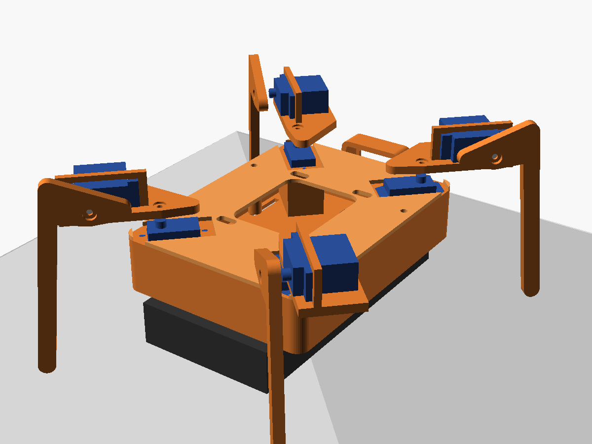
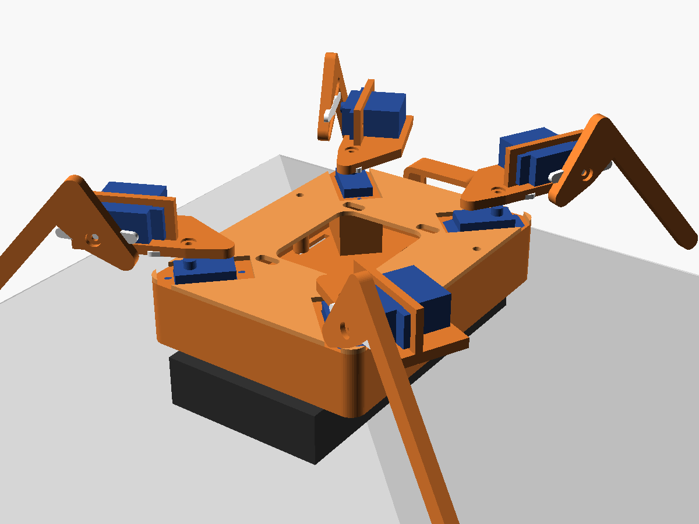

# Паучок v1 — четвероногий робот на 8 сервах

Встаёт, ходит, поворачивает на месте, машет лапой, танцует. Мордочка на OLED, управление с телефона по Wi‑Fi.
Мозг — любая ESP32 (classic, C3, S3 или Cardputer через Grove): сервы висят на драйвере PCA9685, от платы нужны только два провода I²C.
Питание — пауэрбанк под брюхом.

Дизайн: [спека](../docs/superpowers/specs/2026-11-25-quadruped-v1-design.md), [план](../docs/superpowers/plans/2026-11-25-quadruped-v1.md).




## Что нужно

| Что | Шт. | Есть? |
| --- | --- | --- |
| MG90S **180°** (позиционные, металлические шестерни) | 8 + 2 запасные | заказать. Имеющиеся MG90S 360° для ног не подходят |
| PCA9685, 16 каналов | 1 (второй на будущий гексапод) | заказать |
| Электролит 2200 мкФ 10–16 В | 1 | заказать |
| Липучка-ремешок 20 мм | 2 | заказать или стяжки |
| OLED 0,96″ SSD1306 I²C (4 контакта) | 1 | если свободного нет |
| Любая ESP32 | 1 | есть |
| Пауэрбанк с выходом от 2,4 А, шириной до 80 мм, толщиной до 22 мм | 1 | есть |
| USB-кабели: один целый в ESP, один на разрез для серв | 2 | есть |
| Саморезы M3×8 (крышка) и M2×6 (мордочка) | 4 + 2 | набор |

Сервы с пауэрбанка: восемь MG90S при ходьбе берут в среднем 1–2 А, рывки до 3 А гасит конденсатор.

## Печать

PETG, K1 Max, сопло 0,4, 3 периметра, заполнение 20 %, без поддержек. Все STL в `stl/` уже лежат как печатать.
Граммы и время — PrusaSlicer с профилем K1 Max / PETG из `cardputer-rover-v5`, без прогрева.

| Деталь | Шт. | г | Время | Примечание |
| --- | --- | --- | --- | --- |
| `body_bottom` | 1 | 87 | 2 ч 21 | корпус с гнёздами серв бёдер |
| `body_top` | 1 | 17 | 28 мин | крышка |
| `hip_bracket` | 2 | 5 + 5 | 15 + 15 мин | кронштейны **левых** лап |
| `hip_bracket_mirror` | 2 | 5 + 5 | 15 + 15 мин | кронштейны **правых** лап |
| `leg` | 4 | 4 × 4 | 4 × 7 мин | одна деталь на все лапы, для правых просто перевернуть |
| `head` | 1 | 7 | 13 мин | мордочка, лицом на стол |
| **Итого** | | **≈ 148** | **≈ 4 ч 30** | |

Вес робота: сервы 107 г + пластик 148 г + ESP и PCA9685 ≈ 20 г + пауэрбанк ≈ 200 г ≈ 475 г.
На лапу в стойке приходится около 0,4 кг·см, MG90S держат 2 кг·см — запас в пять раз.

### Перед печатью промерь штангенциркулем

Параметры в начале `quad.scad`, взяты из `robot-car/car.scad`. Клоны MG90S бывают разными:

- `sv_l`, `sv_w` — корпус сервы; `sv_hole_pitch` — между отверстиями фланцев (сделаны пазами ±0,5);
- `sv_below_tab` — от верха фланца до дна; `horn_face` — от верха фланца до внешней грани надетой качалки;
- `horn_span`, `horn_hub_d`, `horn_root_w`, `horn_tip_w` — двухлучевая качалка из комплекта;
- `pb_t` — толщина пауэрбанка (по умолчанию 22). Если толще, увеличь: лапы удлинятся сами;
- `oled_win_dz` — где стекло на плате OLED относительно её центра.

Пересобрать всё: `bash spider-quad/tools/export.sh` (STL, рендеры, проверки `assert`).

## Подключение

```
пауэрбанк порт 1 ──(разрезанный USB: красный +5В, чёрный GND)──► клеммник V+ / GND на PCA9685
                                                                └─ конденсатор 2200 мкФ туда же, плюсом к V+
пауэрбанк порт 2 ──(обычный кабель)──► USB платы ESP
ESP SDA ──► SDA на PCA9685 и OLED
ESP SCL ──► SCL на PCA9685 и OLED
ESP 3V3 ──► VCC на PCA9685 и OLED
ESP GND ──► GND на PCA9685 и OLED
```

Если у пауэрбанка один порт — ESP питается от тех же 5 В через вывод 5V/VIN.

Выводы SDA/SCL по умолчанию — classic ESP32 DevKit (21/22). Для другой платы поменяй две строки в
[`firmware/spider_quad/board.h`](firmware/spider_quad/board.h), там готовые варианты для C3, S3 и Cardputer.

Каналы PCA9685:

| Сустав | Передняя левая | Передняя правая | Задняя левая | Задняя правая |
| --- | --- | --- | --- | --- |
| Бедро | 0 | 2 | 4 | 6 |
| Колено | 1 | 3 | 5 | 7 |

## Прошивка

```bash
arduino-cli compile --fqbn esp32:esp32:esp32 spider-quad/firmware/spider_quad
arduino-cli upload --fqbn esp32:esp32:esp32 -p /dev/cu.usbserial-110 spider-quad/firmware/spider_quad
```

Для C3 — `esp32:esp32:esp32c3`, для S3 — `esp32:esp32:esp32s3`. Порт смотри в `arduino-cli board list`.
Нужны ядро esp32:esp32 3.3.x и библиотеки Adafruit SSD1306 и Adafruit GFX (уже стоят).

Тесты логики движения на компьютере: `make -C spider-quad/firmware/test`.

## Первый запуск

1. Прошить, подключить PCA9685 и сервы, **качалки пока не надевать**.
2. С телефона подключиться к Wi‑Fi `spider-quad` (пароль `spiderquad`) и открыть http://192.168.4.1.
3. Раскрыть «Калибровка», нажать «Все в 90°». Все сервы встанут в середину хода.
4. Собрать робота: надеть качалки и детали так, чтобы бедро смотрело по диагонали наружу, а лапа — отвесно вниз.
5. Нажать «Стойка» и подогнать каждую серву кнопками −/+. Если сустав двигается не в ту сторону (лапа «вперёд» уходит назад, колено «вверх» уходит вниз) — «⇄». Затем «Сохранить».
6. Встать на пол, «Привет», потом держать ▲.

Пока стрелка зажата, робот идёт. Отпустил стрелку, свернул вкладку или отвалился Wi‑Fi — через секунду он сам встаёт в стойку.

## Сборка механики

- Серва бедра вставляется в гнездо в углу корпуса валом вверх, фланцы на башню, саморезы из комплекта.
- Кронштейн бедра садится на качалку бедра. Центральный винт качалки проходит через перемычку кронштейна и прижимает его. Если винт не достаёт, уменьши `hub_web`.
- Серва колена вставляется в окно стенки кронштейна валом наружу, фланцы на стенку.
- Лапа садится на качалку колена тем же способом.
- Плату OLED вставить в мордочку сзади, провода в паз передней стенки, мордочку прикрутить двумя M2.
- ESP и PCA9685 положить на дно (двусторонний скотч), крышку прикрутить четырьмя M3.
- Пауэрбанк прижать к брюху двумя липучками через прорези в дне.
