# Калибровка

Безопасный диапазон: остальные суставы в stand, сустав ведётся от stand в обе стороны до первого касания корпуса или соседних деталей. Картинки — `calib/<сустав>_<угол>.png`.

| Канал | Сустав | GPIO | Stand | Безопасно | 0° | 90° | 180° |
| --- | --- | --- | --- | --- | --- | --- | --- |
| 0 | R1 | 15 | 135 | 87–180 | 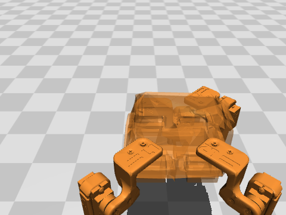 | 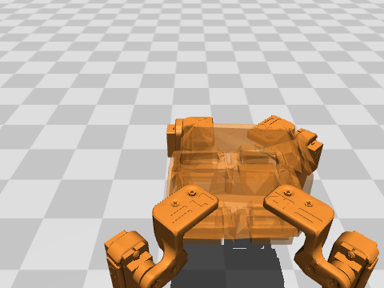 | 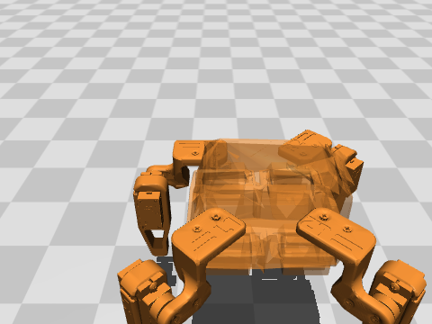 |
| 1 | R2 | 2 | 45 | 0–93 | 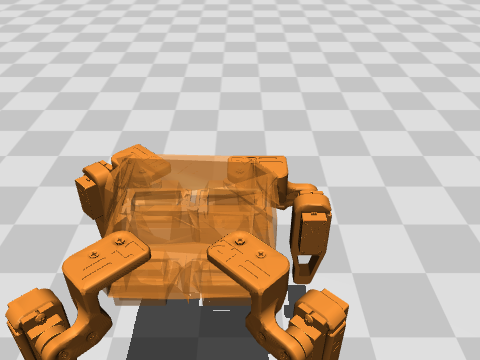 |  | 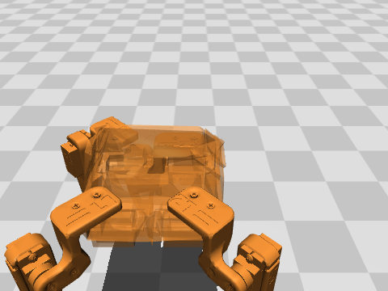 |
| 2 | L1 | 23 | 45 | 0–95 | 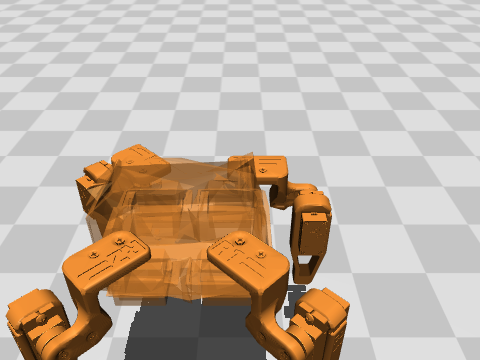 | 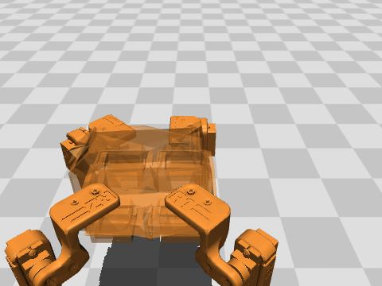 | 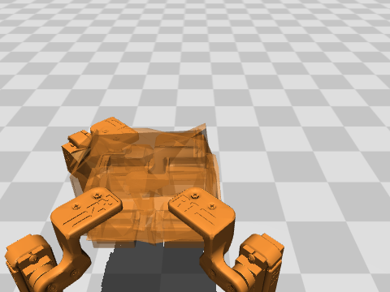 |
| 3 | L2 | 19 | 135 | 85–180 | 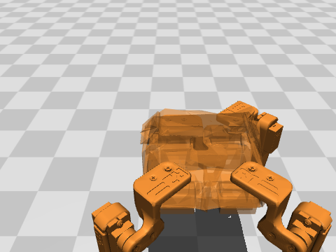 | 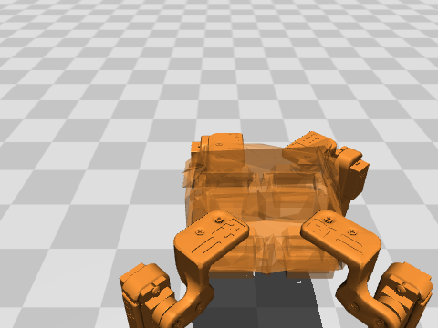 | 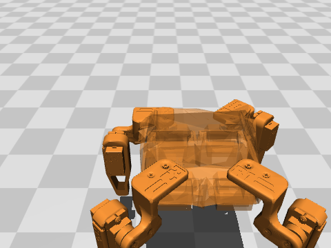 |
| 4 | R4 | 4 | 0 | 0–180 | 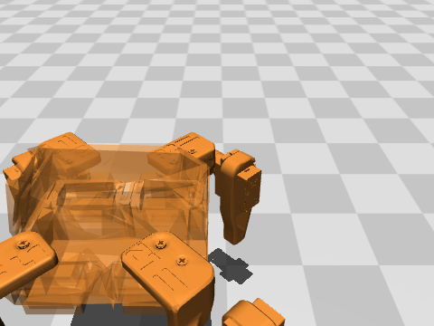 | 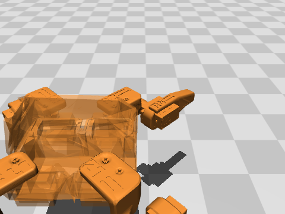 | 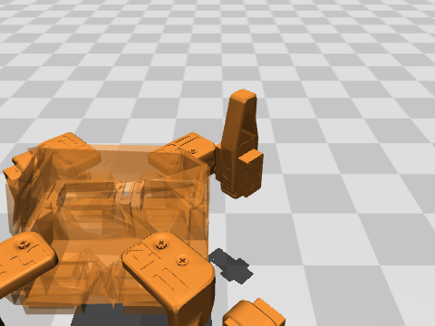 |
| 5 | R3 | 16 | 180 | 0–180 | 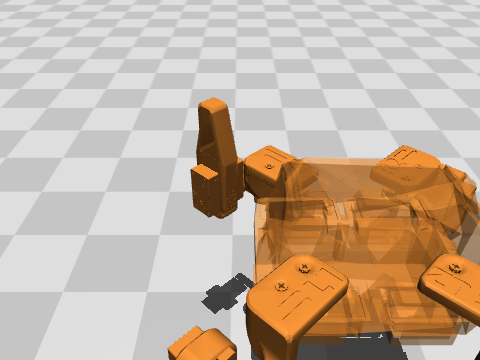 | 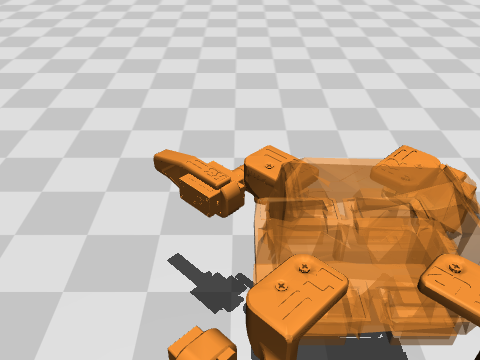 | 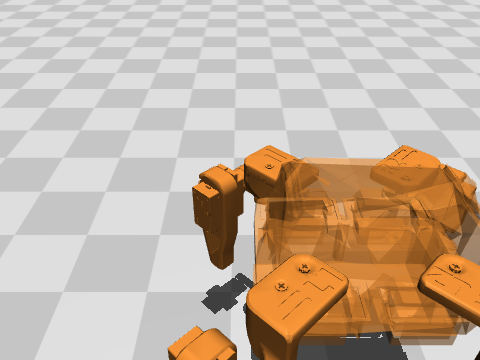 |
| 6 | L3 | 17 | 0 | 0–180 | 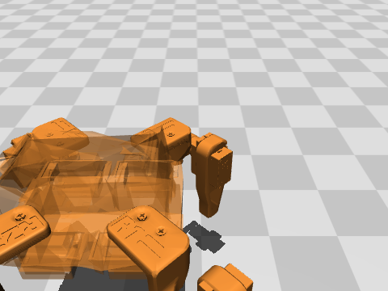 | 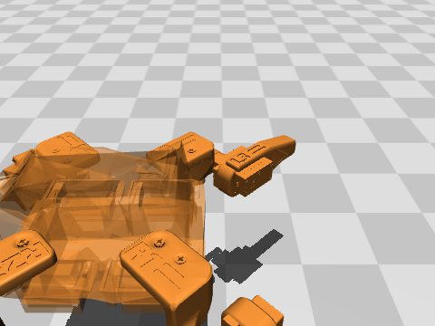 | 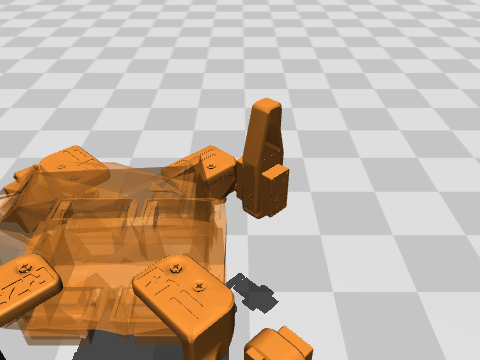 |
| 7 | L4 | 18 | 180 | 0–180 | 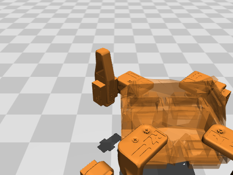 | 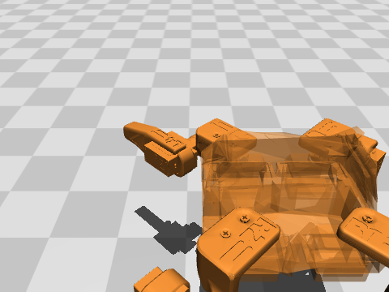 | 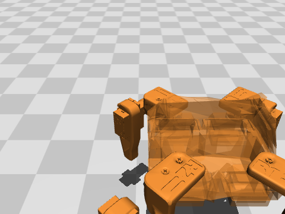 |
